<style>
section {font-family:"Microsoft JhengHei",sans-serif;background:#f3f7fb;color:#233349;font-size:23px;line-height:1.4;padding:32px 42px 38px;justify-content:flex-start;border-top:7px solid #147c8c;}
h1 {font-size:48px;} h2 {position:static;font-size:30px;color:#12374c;margin:0 0 16px;padding-bottom:12px;border-bottom:2px solid #b6cdd8;} h3 {font-size:23px;color:#087e8b;margin:0 0 12px;}
.cols {display:grid;grid-template-columns:1fr 1fr;gap:28px;font-size:21px;align-items:start;} .cols>div {min-width:0;} p {margin:10px 0;} li {margin:6px 0;} ul,ol {padding-left:1.25em;margin:8px 0;} strong {color:#087e8b;}
pre {background:#e4edf4;border:1px solid #c5d6e3;border-radius:8px;padding:12px;font-size:16px;line-height:1.38;} code {font-family:Consolas,monospace;} pre code {font-size:inherit;} pre {white-space:pre-wrap;overflow-wrap:anywhere;} section {box-sizing:border-box;} .cols h3 {font-size:22px;}
table {font-size:20px;width:100%;display:table;} th {background:#dcebf0;color:#12374c;} td,th {padding:8px;border-color:#cbd9e2;} blockquote {border-left:4px solid #e9ac4b;background:#fff4dd;padding:10px;}
img {max-width:100%;max-height:320px;object-fit:contain;} .cols img {max-height:260px;width:100%;} .cols:has(img) {font-size:20px;} .cols:has(img) li {margin:4px 0;} section.lead {justify-content:center;background:#12374c;color:#e6f3f7;} section.lead h1 {color:white;} section::after {font-size:14px;color:#7994a5;}
section.dfs-steps .cols img {max-height:195px;} section.dfs-steps table {font-size:19px;} section.dfs-steps td, section.dfs-steps th {padding:5px 10px;} section.dfs-steps h3 {margin-bottom:8px;}
</style>

<!-- _class: lead -->

# 山東邀請賽｜四題解析

2024 CCPC 山東邀請賽

I. Left Shifting · F. Divide the Sequence

H. Stop the Castle · E. Sensors

2026.10.24


---


## 四題的解題路線

| 題目 | 核心問題 | 方法 | 時間 |
| --- | --- | --- | --- |
| I. Left Shifting | 左移幾次才能首尾相同？ | 環狀下標、枚舉 | O(n) |
| F. Divide the Sequence | 每種段數的最大加權和？ | 後綴和、排序、貪心 | O(n log n) |
| H. Stop the Castle | 最少增加幾個障礙？ | 二分圖最大匹配 | O(n³) |
| E. Sensors | 塗色後哪些區間恰有一顆紅球？ | 線段樹、封頂通知 | O((n+m) log n) |

---

## I｜Left Shifting 題意

<div class="cols">
<div>

### 左移與美麗字串

字串的第一個與最後一個字元相同，稱為美麗。

```text
abcde → bcdea → cdeab
原字串   左移 1 次  左移 2 次
```

求最小非負左移次數 d；無解輸出 −1。

</div>
<div>

### 官方樣例

| 字串 | 最小 d | 原因 |
| --- | --- | --- |
| helloccpc | 3 | loccpchel 首尾皆 l |
| abcdcba | 0 | 原本首尾皆 a |
| x | 0 | 唯一字元同時是首尾 |
| abc | −1 | 所有旋轉都不符合 |

每筆 n ≤ 5×10⁵，所有測資的 n 總和 ≤ 5×10⁵。

</div>
</div>

---

## I｜左移只改變起點

<div class="cols">
<div>

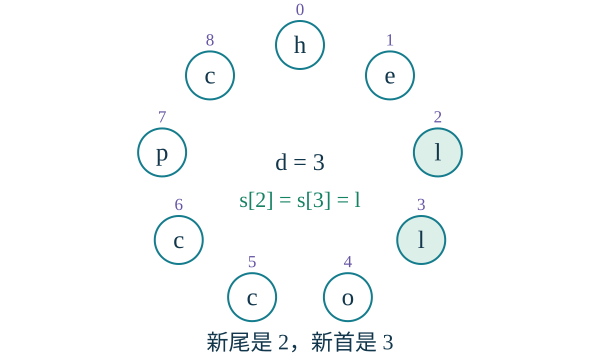

環上位置不變；選下標 d 當新起點。

</div>
<div>

### 新首尾是原字串的哪兩格？

- 新首字元：s[d]。
- 新尾字元：s[(d−1+n) mod n]。
- 尾字元就是環上起點的前一格。

因此只要比較這兩格，不必建立旋轉後的字串。

**成立條件：s[d] = s[(d−1+n) mod n]。**

只需枚舉 0…n−1；左移 n 次回到原字串。

</div>
</div>

---

## I｜樣例的最小左移量

S = helloccpc，下標從 0 開始。

| d | 新首字元 s[d] | 新尾字元 | 相同？ |
| --- | --- | --- | --- |
| 0 | h | s[8] = c | 否 |
| 1 | e | s[0] = h | 否 |
| 2 | l | s[1] = e | 否 |
| 3 | l | s[2] = l | 是 |

左移 3 次：**loccpchel**，首尾都是 l。

d = 0、1、2 都失敗，因此最小答案是 **3**。

---

## I｜線性枚舉與正確性

<div class="cols">
<div>

### 演算法

1. 依序枚舉 d = 0、1、…、n−1。
2. 算出前一格 prev = (d−1+n) mod n。
3. 若 s[d] = s[prev]，立即回傳 d。
4. 全部失敗則回傳 −1。

</div>
<div>

### 為什麼得到最小答案？

每個可能的旋轉都對應一個 d。

比較原字串的兩個下標，等價於比較旋轉後的首尾。

枚舉順序由小到大，所以第一個成功值就是最小值。

**時間 O(n)，額外空間 O(1)**，不含輸入字串。

</div>
</div>

---

## I｜實作與邊界

<div class="cols">
<div>

```cpp
int solve(const string& s) {
    int n = (int)s.size();
    for (int d = 0; d < n; ++d) {
        int prev = (d - 1 + n) % n;
        if (s[d] == s[prev]) return d;
    }
    return -1;
}
```

</div>
<div>

### 邊界情況

- d = 0 必須比較 s[0] 與 s[n−1]。
- n = 1 自然得到 d = 0。
- 找到後立即停止，才能保證最小。
- 每次建立完整旋轉字串，總時間可能達 O(n²)。

多測時逐筆讀入字串並輸出 solve(s)。

</div>
</div>

---

## F｜Divide the Sequence 題意

<div class="cols">
<div>

### 每個 k 都要一個答案

將 a₁…aₙ 分成恰好 k 段連續、非空子陣列，每個元素恰屬一段。

由左到右的段和為 s₁…sₖ，最大化：

$$1s_1+2s_2+\cdots+ks_k$$

輸出 k = 1…n 的全部 n 個最大值。

</div>
<div>

### 官方樣例：k = 3

```text
[1] [3 −4] [5 −1 −2]
```

段和是 1、−1、2，分數：

**1×1 + 2×(−1) + 3×2 = 5。**

n ≤ 5×10⁵，|aᵢ| ≤ 10⁶。

多測的 n 總和 ≤ 5×10⁵。

</div>
</div>

---

## F｜一刀增加一個後綴和

<div class="cols">
<div>

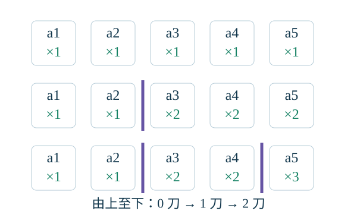

每加一刀，其右方所有元素的係數都增加 1。

</div>
<div>

### 從 k = 1 出發

沒有切割時，每個元素係數都是 1，分數是總和 T。

在 a₂ 後切一刀，增加：

**a₃ + a₄ + a₅。**

再在 a₄ 後切一刀，增加：

**a₅。**

兩次增加可以直接相加，得到係數 1、1、2、2、3。

</div>
</div>

---

## F｜加權段和的等價式

切在 a₂ 與 a₄ 後：

$$
1(a_1+a_2)+2(a_3+a_4)+3(a_5+a_6)
$$

$$
=(a_1+\cdots+a_6)+(a_3+\cdots+a_6)+(a_5+a_6)
$$

令 pᵢ = aᵢ + … + aₙ。在位置 i 後切一刀，貢獻為 pᵢ₊₁。

**分數 = T + 所有選定切點的後綴和。**

每個元素的係數，等於 1 加上它左方的切點數，因此任意多刀都成立。

---

## F｜為什麼選最大的 k−1 個？

<div class="cols">
<div>

### 切點互相獨立

可用位置是 1…n−1，對應 p₂…pₙ。

任選 k−1 個不同切點，按原位置排序後，都能形成 k 個非空連續段。

因此只需在 n−1 個固定貢獻中，選恰好 k−1 個，使總和最大。

</div>
<div>

### 交換論證

若選了較小值 x，卻沒選較大值 y，把 x 換成 y，仍是合法切割，分數不減。

重複交換，即得到最大的 k−1 個貢獻。

**即使貢獻為負，仍須選滿 k−1 個。**

排序的是切點的貢獻值；原序列不重新排序。

</div>
</div>

---

## F｜官方樣例的切點貢獻

a = [1,3,−4,5,−1,−2]，總和 T = 2。

| 切在位置 i 後 | 右方後綴 | 貢獻 pᵢ₊₁ |
| --- | --- | --- |
| 1 | [3,−4,5,−1,−2] | 1 |
| 2 | [−4,5,−1,−2] | −2 |
| 3 | [5,−1,−2] | 2 |
| 4 | [−1,−2] | −3 |
| 5 | [−2] | −2 |

降序排列貢獻：**2、1、−2、−2、−3**。

k = 3 時選位置 3、1，按位置排列後得到 **[1] [3,−4] [5,−1,−2]**。

---

## F｜一次排序產生全部答案

| 段數 k | 新加入的貢獻 | 最大分數 |
| --- | --- | --- |
| 1 | 無 | 2 |
| 2 | +2 | 4 |
| 3 | +1 | 5 |
| 4 | −2 | 3 |
| 5 | −2 | 1 |
| 6 | −3 | −2 |

輸出：**2 4 5 3 1 −2**。

答案不一定隨段數增加：必須切出更多段時，可能被迫選負貢獻。

---

## F｜後綴和與排序流程

<div class="cols">
<div>

### 演算法

1. 計算序列總和 T。
2. 從右往左累加，收集 pₙ、pₙ₋₁、…、p₂。
3. 將這 n−1 個貢獻降序排序。
4. 先輸出 T，代表 k = 1。
5. 依序加入下一個貢獻並輸出，得到 k = 2…n。

</div>
<div>

### 複雜度與數值範圍

- 後綴和：O(n)。
- 排序：O(n log n)。
- 輸出所有答案：O(n)。
- 額外空間：O(n)。

總和、後綴和、答案都使用 **long long**。

答案絕對值不超過 10⁶·n(n+1)/2，可能約為 1.25×10¹⁷，需 64 位元。

</div>
</div>

---

## F｜實作

<div class="cols">
<div>

```cpp
// a[1..n]，每筆測資呼叫一次
long long total = 0, suffix = 0;
for (int i = 1; i <= n; ++i)
    total += a[i];
vector<long long> cuts;
for (int i = n; i >= 2; --i) {
    suffix += a[i];
    cuts.push_back(suffix);
}
sort(cuts.rbegin(), cuts.rend());
```

</div>
<div>

```cpp
long long cur = total;
cout << cur;
for (long long gain : cuts) {
    cur += gain;
    cout << ' ' << cur;
}
cout << '\n';
```

不加入 p₁：它對應在第一個元素前切割，會產生空段。

n = 1 時 cuts 為空，只輸出 a₁。

</div>
</div>

---

## I、F｜從操作推導貢獻

| | I. Left Shifting | F. Divide the Sequence |
| --- | --- | --- |
| 原本的操作 | 左移整個字串 | 將序列分段 |
| 真正需要追蹤 | 新首尾的原下標 | 每刀增加的後綴和 |
| 關鍵轉換 | 比較環上相鄰兩格 | 加權段和 = T + 切點貢獻 |
| 最佳解的取得 | 由小到大枚舉 d | 降序取最大的 k−1 個 |
| 時間 | O(n) | O(n log n) |

接下來的 H、E：把互攻關係轉成二分圖，把區間狀態轉成節點貢獻。


---

## 兩題各用什麼

| | H. 阻止城堡 | E. 感測器 |
| --- | --- | --- |
| 問的事 | 最少再放幾個障礙 | 每次塗色後誰在啟動 |
| 規模 | $n,m\le 200$ | $n,m\le 5\cdot 10^5$ |
| 方法 | 二分圖最大匹配 | 線段樹上的封頂通知 |
| 答案 | $k=P-M$，並輸出格子 | 啟動編號的平方和 |


---


## H｜題目

<div class="cols">
<div>

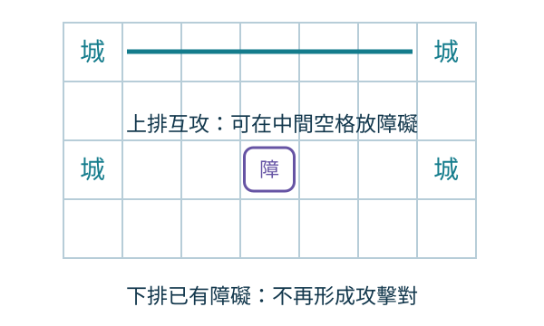

</div>
<div>

- 棋盤有 $10^9$ 行、$10^9$ 列，上有 $n$ 座城堡、$m$ 個障礙
- 城堡是車：同行或同列，且中間沒有其他棋子，就能互攻
- 再放最少的障礙，讓所有互攻都消失
- 不能放在已經有棋子的格子；做不到就輸出 $-1$
- $n,m\le 200$，座標到 $10^9$

</div>
</div>


---


## 攻擊對 / 什麼時候無解

<div class="cols">
<div>

### 攻擊對

同一行把城堡和障礙一起按欄位排序。

- 排序後緊鄰、而且兩顆都是城堡：它們正在互攻
- 中間夾著障礙或其他城堡：這一對已經被擋住
- 列的方向同樣做一次
- 不要把同一行所有城堡兩兩相連

這樣得到的每一對，就是後面二分圖的一個點。

</div>
<div>

### 什麼時候無解

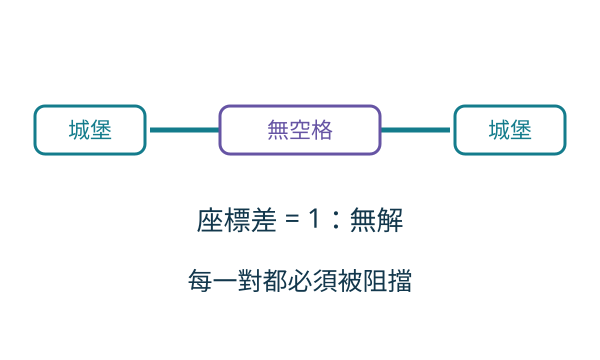

- 互攻的兩座城堡若座標只差 $1$，中間沒有空格
- 障礙沒有地方放，這筆資料輸出 $-1$
- 第 4 筆樣例的 $(1,3)$ 與 $(2,3)$ 就是這種
- 每一對中間都至少有一格時，一定有解

</div>
</div>


---


## 為什麼用匹配｜兩橫、兩縱的攻擊對

<div class="cols">
<div>

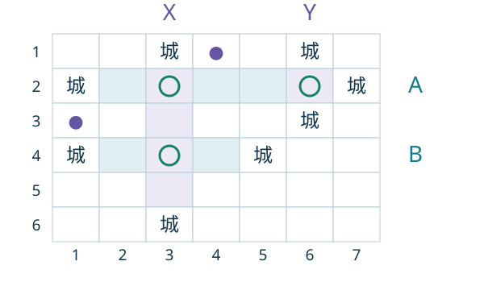

- A：第 2 行，城堡在第 1、7 欄。
- B：第 4 行，城堡在第 1、5 欄。
- X：第 3 欄，城堡在第 1、6 行。
- Y：第 6 欄，城堡在第 1、3 行。

圖示只畫出指定攻擊對；● 是既有障礙，用來隔開其他互攻。

</div>
<div>

### 三個交叉格，如何選兩個？

- **A–X：(2,3)**，一顆可阻擋 A、X。
- **A–Y：(2,6)**，一顆可阻擋 A、Y。
- **B–X：(4,3)**，一顆可阻擋 B、X。
- B 不連 Y：第 6 欄不在 B 的開區間 (1,5) 內。

選 **(2,6)、(4,3)**，四個攻擊對全部被阻擋。

**P = 4，M = 2，最少障礙 = 2。**

一顆最多解決兩對，因此一顆一定不夠。

</div>
</div>


---


## 二分圖與最大匹配

<div class="cols">
<div>

### 交叉格對應三條邊

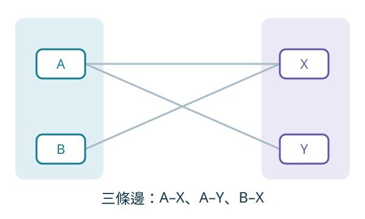

- 左點 A、B 是橫向攻擊對；右點 X、Y 是縱向攻擊對。
- 邊為 A–X、A–Y、B–X；不存在 B–Y。
- 點代表攻擊對，邊代表可同時阻擋兩對的空格。

</div>
<div>

### 最大匹配有兩條邊

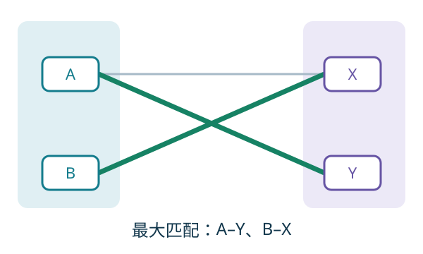

- 選 **A–Y、B–X**：每個頂點恰好使用一次。
- 對應障礙 **(2,6)、(4,3)**，共 2 顆。
- 若先選 A–X，B 會暫時無處可配。
- DFS 可將 A 改配 Y，再把 X 配給 B。

</div>
</div>


---


## DFS 增廣｜1 / 5　初始匹配

<!-- _class: dfs-steps -->

<div class="cols">
<div>

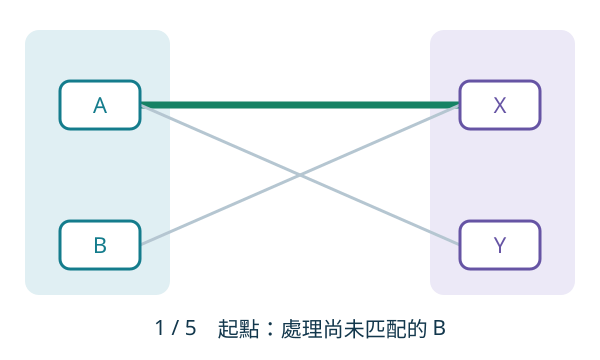


### 變數狀態

| 變數 | 本步數值 |
| --- | --- |
| `matchR[X]` | `A` |
| `matchR[Y]` | `-1` |
| `vis[X]` | `false` |
| `vis[Y]` | `false` |

</div>
<div>

### 呼叫與操作

`DFS(B)`

尚未開始本輪搜尋。

`matchR[v]`：右點 v 目前記錄的左側對象；`-1` 表示未匹配。

`vis[v]`：本輪 DFS 是否已訪問右點 v；每次從新左點出發前清空。


沿用前頁的 A、B、X、Y 與三條邊，觀察如何從一條匹配增為兩條。

目前只有 A–X。B 尚未匹配，準備呼叫 DFS(B)。

綠色代表目前的匹配；灰色代表可用但尚未選取的邊。

</div>
</div>


---


## DFS 增廣｜2 / 5　尋找 B 的位置

<!-- _class: dfs-steps -->

<div class="cols">
<div>

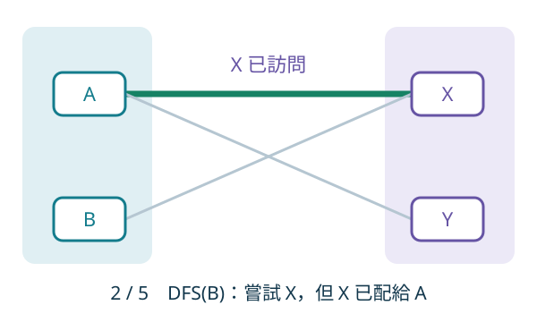


### 變數狀態

| 變數 | 本步數值 |
| --- | --- |
| `matchR[X]` | `A` |
| `matchR[Y]` | `-1` |
| `vis[X]` | `true` |
| `vis[Y]` | `false` |

</div>
<div>

### 呼叫與操作

`DFS(B) → DFS(A)`

B 訪問 X；因 matchR[X] = A，遞迴處理 A。


B 只有鄰居 X。標記 vis[X]，發現 matchR[X] = A，於是遞迴呼叫 DFS(A)。

DFS(B) 暫停，等待 A 能否找到其他位置；此時不改匹配。

</div>
</div>


---


## DFS 增廣｜3 / 5　替 A 尋找新位置

<!-- _class: dfs-steps -->

<div class="cols">
<div>

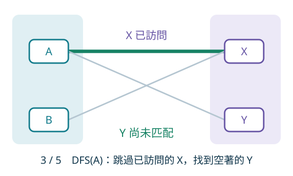


### 變數狀態

| 變數 | 本步數值 |
| --- | --- |
| `matchR[X]` | `A` |
| `matchR[Y]` | `-1` |
| `vis[X]` | `true` |
| `vis[Y]` | `true` |

</div>
<div>

### 呼叫與操作

`DFS(B) → DFS(A)`

A 略過已訪問的 X，標記 vis[Y]；Y 空著，準備改配。


A 的鄰居是 X、Y。X 本輪已訪問，略過；標記 vis[Y] 後發現 Y 未匹配，因此找到增廣路 B–X–A–Y。

路徑依序為未匹配邊、匹配邊、未匹配邊，末端是空著的右點 Y。

</div>
</div>


---


## DFS 增廣｜4 / 5　遞迴回傳：A 改配 Y

<!-- _class: dfs-steps -->

<div class="cols">
<div>

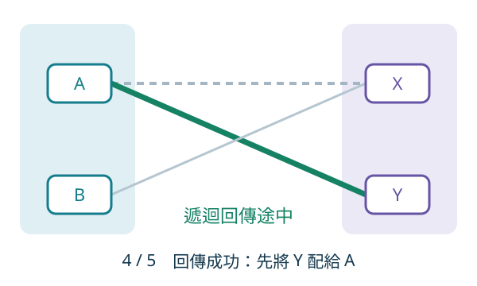


### 變數狀態

| 變數 | 本步數值 |
| --- | --- |
| `matchR[X]` | `A` |
| `matchR[Y]` | `A` |
| `vis[X]` | `true` |
| `vis[Y]` | `true` |

</div>
<div>

### 呼叫與操作

`DFS(A) 回傳 true → DFS(B)`

先寫入 matchR[Y] = A；matchR[X] 仍暫留 A。


設定 matchR[Y] = A，DFS(A) 回傳 true。接下來恢復尚未完成的 DFS(B)。

此刻 matchR[X] 仍是 A；這只是回傳中的暫時狀態，不能當作已完成的匹配。

</div>
</div>


---


## DFS 增廣｜5 / 5　完成增廣：B 配給 X

<!-- _class: dfs-steps -->

<div class="cols">
<div>

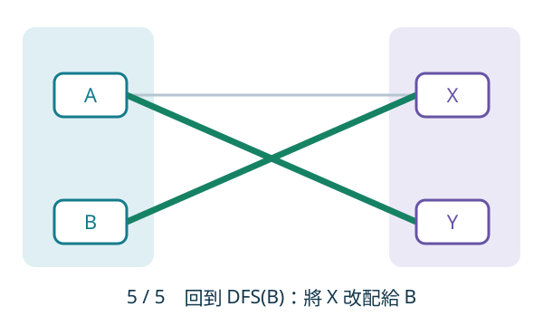


### 變數狀態

| 變數 | 本步數值 |
| --- | --- |
| `matchR[X]` | `B` |
| `matchR[Y]` | `A` |
| `vis[X]` | `true` |
| `vis[Y]` | `true` |

</div>
<div>

### 呼叫與操作

`DFS(B) 回傳 true`

寫入 matchR[X] = B；完成本輪，匹配數 +1。


DFS(B) 收到 true，設定 matchR[X] = B。最終匹配是 A–Y、B–X，匹配數由 1 增為 2。

若遞迴找不到空位，就不更新這條邊，改試其他鄰居；全部失敗才回傳 false。

</div>
</div>


---


## 匈牙利｜增廣與重新配對

<div class="cols">
<div>

### 從空匹配逐一加入左點

1. 所有右點起初都未配對。
2. 選下一個左點 u，清空這一輪的 `vis`。
3. DFS 嘗試替 u 找位置；成功時匹配數 +1。
4. 失敗代表目前沒有增廣路，繼續下一個左點。

每次成功保留舊匹配數，並增加一對；所有左點處理完即得最大匹配（增廣路定理）。

</div>
<div>

### DFS 如何「請舊對象搬家」

- 先試 u 的右鄰居 v；本輪看過便略過。
- v 空著：直接配給 u，回傳成功。
- v 已配給 w：遞迴替 w 找別的位置。
- w 搬家成功，v 才能交給 u；失敗則試下一條邊。

例：B 想要 X，但 X 屬於 A。若 A 可搬到 Y，就依序更新 A–Y、B–X；失敗時不改舊匹配。

</div>
</div>


---


## 增廣程式 / 匹配主程式

<div class="cols">
<div>

### 增廣程式

```cpp
bool dfs(int u) {
    for (int v : g[u]) {
        if (vis[v]) continue;
        vis[v] = true;
        if (matchR[v] == -1 || dfs(matchR[v])) {
            matchR[v] = u;
            return true;
        }
    }
    return false;
}
```

`matchR[v] = u` 表示右側 $v$ 目前配給左側 $u$。

</div>
<div>

### 匹配主程式

```cpp
int maxMatch(int L, int R) {
    fill(matchR, matchR + R, -1);
    int ans = 0;
    for (int u = 0; u < L; u++) {
        fill(vis, vis + R, false);
        if (dfs(u)) ans++;
    }
    return ans;
}
```

設左右點數為 H、V，邊數為 E。DFS 匹配時間 O(H·E)；H、V 都小於 n，因此最壞 O(n³)，n ≤ 200 時可行。

</div>
</div>


---


## 一格就是一條邊 / 最少幾顆

<div class="cols">
<div>

### 一格就是一條邊

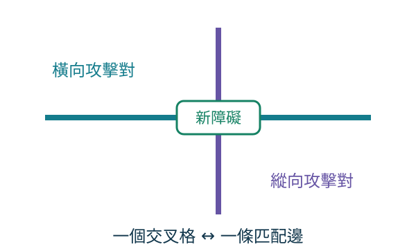

</div>
<div>

### 最少幾顆

$$
k = P - M
$$

- 每條匹配邊：一顆障礙同時解決兩個攻擊對
- 沒配上的 $P-2M$ 個攻擊對：各自再放一顆
- 加起來是 $M+(P-2M)=P-M$
- 下界：每個攻擊對指定一顆阻擋它的障礙。被指定兩次的障礙形成匹配，數量 $d\le M$；共放 $k$ 顆時，$P\le k+d\le k+M$。

</div>
</div>


---


## H｜官方樣例與答案還原

<div class="cols">
<div>

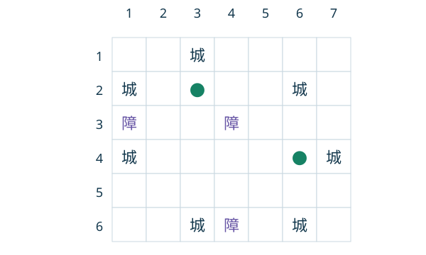

綠色標記是新障礙：**(2,3)、(4,6)**。

</div>
<div>

### 四個攻擊對，兩條匹配邊

| 橫向攻擊對 | 配對的縱向攻擊對 | 新障礙 |
| --- | --- | --- |
| 第 2 行，欄 (1,6) | 第 3 欄，行 (1,6) | (2,3) |
| 第 4 行，欄 (1,7) | 第 6 欄，行 (2,6) | (4,6) |

第 6 行、第 1 欄的城堡已被舊障礙隔開。

P = 4、M = 2，輸出 2 顆障礙；每個攻擊對均被覆蓋。

</div>
</div>


---


## H｜未匹配攻擊對的還原

<div class="cols">
<div>

### 例：三個攻擊對，只有一條匹配邊

橫向 A：第 2 行，欄 (1,7)。

橫向 B：第 4 行，欄 (1,7)。

縱向 X：第 3 欄，行 (1,6)。

二分圖只有 A–X、B–X，最大匹配 M = 1。

</div>
<div>

### 選 A–X 後，補上 B

| 對象 | 還原方式 | 障礙座標 |
| --- | --- | --- |
| 匹配 A–X | 放在兩段交叉格 | (2,3) |
| 未匹配 B | 放在左端點右側一格 | (4,2) |

共放 P − M = 3 − 1 = **2 顆**。

一般而言：未匹配橫段放 (r,c₁+1)，縱段放 (r₁+1,c)。無解檢查保證這些位置在開區間內。

</div>
</div>


---


## 掃出攻擊對 / 建邊

<div class="cols">
<div>

### 掃出攻擊對

```cpp
sort(v.begin(), v.end()); // 同一行，依欄位
for (int i = 0; i + 1 < (int)v.size(); i++) {
    if (v[i].tp || v[i + 1].tp) continue; // 有一邊是障礙
    if (v[i + 1].pos == v[i].pos + 1) return IMPOSSIBLE;
    hor.push_back({row, v[i].pos, v[i + 1].pos});
}
```

列的方向把 `pos` 改成列號，推進 `ver`。

</div>
<div>

### 建邊

```cpp
for (int i = 0; i < H; i++) for (int j = 0; j < V; j++) {
    int col = ver[j].fixed, row = hor[i].fixed;
    if (hor[i].L < col && col < hor[i].R &&
        ver[j].L < row && row < ver[j].R)
        g[i].push_back(j);
}
```

交叉格 $(row,col)$ 落在兩段開區間裡，而且這兩段本來就沒有棋子。

</div>
</div>


---


## 還原格子 / H 題容易錯

<div class="cols">
<div>

### 還原格子

```cpp
for (int j = 0; j < V; j++) if (matchR[j] != -1) {
    int i = matchR[j];
    usedH[i] = usedV[j] = 1;
    place(hor[i].fixed, ver[j].fixed);
}
```

`usedH[i]==0` 的橫向對再放 $(r,c_1+1)$，縱向同理。多測要清鄰接表和 `matchR`。

</div>
<div>

### H 題容易錯

- 同一行不相鄰的城堡也拿去連邊
- 座標差為 1 卻還去建圖
- `vis` 沒有每輪清空，或 `matchR` 沒設成 $-1$
- 只輸出匹配的交叉格，忘了沒配上的攻擊對
- 多測沿用上一筆的邊

</div>
</div>


---


## E｜Sensors：球、感測器與操作

<div class="cols">
<div>

### 球的顏色只會由紅變藍

n 顆球由左到右編為 **0…n−1**，初始全紅。

共做 n 次操作：第 t 次把下標 aₜ 的球塗藍，之後不會變回紅色。

題目保證解碼後的 aₜ 互不相同，因此每顆球恰好被塗一次，最後全藍。

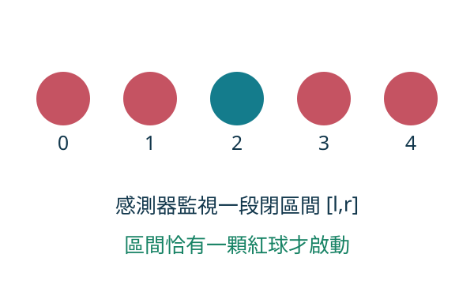

</div>
<div>

### 感測器是一段固定監視範圍

m 個感測器編為 **1…m**；第 j 個監視閉區間 [lⱼ,rⱼ]，包含兩端。

| 範圍內剩餘紅球數 | 感測器狀態 |
| --- | --- |
| 0 | 不啟動 |
| 1 | 啟動 |
| 2 顆以上 | 不啟動 |

啟動是依「目前顏色」重新判定；曾經啟動的感測器也會停止。

不同感測器的區間可以重疊。

</div>
</div>

---

## E｜要求輸出：啟動編號的平方和

<div class="cols">
<div>

### 每個時刻輸出一個整數

令 vₜ 為第 t 次操作完成後，所有啟動感測器的**編號平方和**。

$$v_t=\sum_{j\text{ 在時刻 }t\text{ 啟動}}j^2$$

- v₀：尚未塗色的初始答案。
- 每次塗色後輸出 vₜ，共 n+1 個答案。
- 沒有感測器啟動時，答案為 0。
- 輸出平方和，不是啟動數量或球的下標。

</div>
<div>

### 例：n = 5，初始全紅

| 感測器編號 | 監視區間 | 初始紅球數 |
| --- | --- | --- |
| 1 | [2,4] | 3 |
| 2 | [2,3] | 2 |
| 3 | [3,3] | 1 |
| 4 | [0,2] | 3 |

初始僅 3 號啟動，**v₀ = 3² = 9**。

塗藍下標 2 後，2、3 號啟動：

**v₁ = 2² + 3² = 13**。

</div>
</div>

---

## E｜例一：同一個感測器會啟動，也會停止

n = 3，只有 1 號感測器，監視 [0,2]。依序塗藍下標 1、0、2。

| 時刻 | 本次塗藍 | 三顆球：下標 0、1、2 | 1 號範圍內紅球數 | 狀態 | 答案 v |
| --- | --- | --- | --- | --- | --- |
| 初始 | 無 | 🔴 🔴 🔴 | 3 | 不啟動 | 0 |
| 第 1 次後 | 1 | 🔴 🔵 🔴 | 2 | 不啟動 | 0 |
| 第 2 次後 | 0 | 🔵 🔵 🔴 | 1 | 啟動 | 1² = 1 |
| 第 3 次後 | 2 | 🔵 🔵 🔵 | 0 | 不啟動 | 0 |

**紅球數 3 → 2 → 1 → 0；只有「1」的時刻啟動。**

輸出包含初始時刻，因此是 **0 0 1 0**，共 n+1 = 4 個數。

---

## E｜例二：重疊區間可以同時啟動

n = 3；1 號監視 [0,1]，2 號監視 [1,2]，3 號監視 [1,1]。

| 操作後 | 球的顏色：0、1、2 | 紅球數：1 號／2 號／3 號 | 啟動編號 | 答案 |
| --- | --- | --- | --- | --- |
| 初始 | 🔴 🔴 🔴 | 2／2／1 | {3} | 9 |
| 塗藍 0 | 🔵 🔴 🔴 | 1／2／1 | {1,3} | 1²+3² = 10 |
| 塗藍 2 | 🔵 🔴 🔵 | 1／1／1 | {1,2,3} | 1²+2²+3² = 14 |
| 塗藍 1 | 🔵 🔵 🔵 | 0／0／0 | 無 | 0 |

只剩下標 1 的紅球時，三個感測器都能看到它，**三個都啟動**。

一顆紅球可以讓多個感測器啟動；判定是各自針對監視區間進行。

---

## E｜例三：編號平方和不是紅球數量

<div class="cols">
<div>

### 延續例二：只剩下標 1 為紅色

- 全場剩餘紅球：1 顆。
- 啟動感測器：1、2、3 號，共 3 個。
- 題目要求的答案：**1²+2²+3² = 14**。

因此輸出的不是 1，也不是 3，而是 **14**。

</div>
<div>

### 單點區間 [1,1] 的意義

區間包含兩端，因此 [1,1] 只監視下標 1。

下標 1 紅色時，3 號啟動；塗藍後，3 號停止。

感測器沒有消耗紅球，也沒有占用權；多個感測器能監視同一顆球。

所有球都變藍後，所有感測器均停止，最後答案必定是 0。

</div>
</div>

---

## E｜輸入編碼與處理順序

<div class="cols">
<div>

### 輸入的操作不是實際球下標

每筆測資依序給出 n、m，接著 m 個感測器區間，最後 n 個編碼 a′₁…a′ₙ。

實際下標必須用上一個答案解出：

$$a_t=(a'_t+v_{t-1})\bmod n$$

每次依序進行：**解碼 → 塗藍 → 更新感測器狀態 → 計算新答案**。

因此不能先把所有操作解碼，再離線處理。

</div>
<div>

### 延續前例

n = 5，已算得 v₀ = 9。

若第一個編碼 a′₁ = 3：

**a₁ = (3 + 9) mod 5 = 2**。

塗藍下標 2，得到 v₁ = 13；下一個操作必須使用 13 解碼。

n、m 各不超過 5×10⁵；多測的 n 總和、m 總和各不超過 5×10⁵。

v 使用 64 位元整數。解碼可寫成 (a′ₜ + vₜ₋₁ % n) % n。

</div>
</div>

---

## E｜例二的完整輸入、解碼與輸出

<div class="cols">
<div>

### 一筆測資的完整輸入

```text
1
3 3
0 1
1 2
1 1
0 1 2
```

依序是：測資數、n 與 m、三個感測器區間、三個**編碼**。

輸出：**9 10 14 0**。

</div>
<div>

### 編碼不等於實際塗色順序

初始答案 v₀ = 9，使用 aₜ = (a′ₜ + vₜ₋₁) mod 3。

| t | 編碼 a′ₜ | 上次答案 | 實際下標 aₜ | 新答案 |
| --- | --- | --- | --- | --- |
| 1 | 0 | 9 | (0+9)%3 = 0 | 10 |
| 2 | 1 | 10 | (1+10)%3 = 2 | 14 |
| 3 | 2 | 14 | (2+14)%3 = 1 | 0 |

輸入是 0、1、2，實際依序塗藍 **0、2、1**。

</div>
</div>

---

## 節點是一段下標 / 改一顆球

<div class="cols">
<div>

### 節點是一段下標

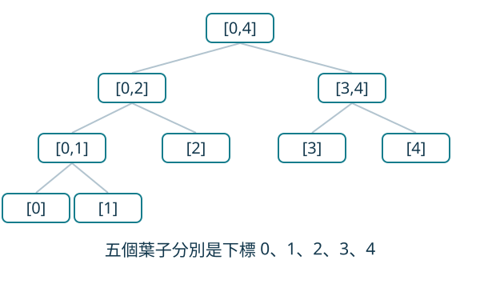

葉子是單一顆球。父節點的紅球數等於兩個孩子之和。一開始全是紅球，節點初值就是區間長度。

</div>
<div>

### 改一顆球

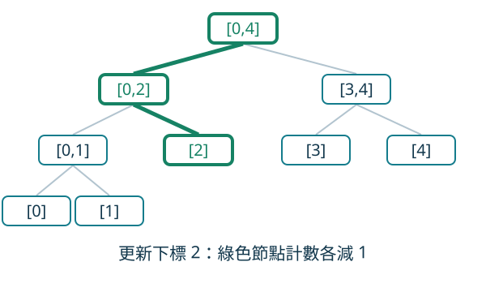

- 只有包含這個下標的節點會減 1
- 它們構成根到葉子的一條鏈，長度 $O(\log n)$
- 鏈以外的節點不動
- 這裡沒有區間加值，不需要把懶標記下推給孩子

</div>
</div>


---


## 一段怎麼拆 / 為什麼用線段樹

<div class="cols">
<div>

### 一段怎麼拆

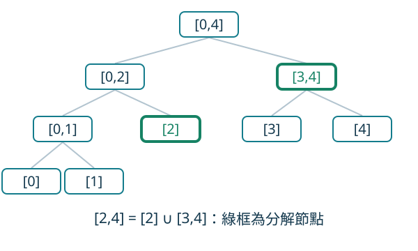

$[2,4]$ 正好是 $[2]$、$[3,4]$。這兩塊不交，拼起來就是原區間，塊數不超過 $2\log n$。

</div>
<div>

### 為什麼用線段樹

1. 每個感測器是一段區間，可以拆成 $O(\log n)$ 個不交的節點
2. 區間裡的紅球數，就是這些節點的紅球數之和
3. 恰有一顆，等於其中一塊是 1、其餘每一塊都是 0
4. 所以每塊只留貢獻 $\min(\text{紅球數},2)$；貢獻和等於 1 才啟動
5. 紅球只會減少。這個貢獻只在計數從 2 變成 1、從 1 變成 0 時減 1
6. 只有這兩個時刻要通知掛在該節點上的感測器

若每次計數變化都通知，一個大節點上可能掛著幾乎全部區間，複雜度退回 $O(nm)$。

</div>
</div>


---


## E｜為什麼 val = 1 等價於恰有一顆紅球？

將一個感測器的區間拆成兩個不交節點，逐塊計算 min(cnt,2)。

| 兩塊真實紅球數 | 兩塊封頂貢獻 | val | 是否啟動 |
| --- | --- | --- | --- |
| (1,0) | (1,0) | 1 | 是 |
| (1,1) | (1,1) | 2 | 否 |
| (4,0) | (2,0) | 2 | 否 |
| (0,0) | (0,0) | 0 | 否 |

所有貢獻皆非負；總和是 1，只可能有一塊是 1、其餘都是 0。

因此不必維護每個感測器的真實紅球總數，只需維護 val。


---


## 封頂之後看什麼 / 哪一次才通知

<div class="cols">
<div>

### 封頂之後看什麼

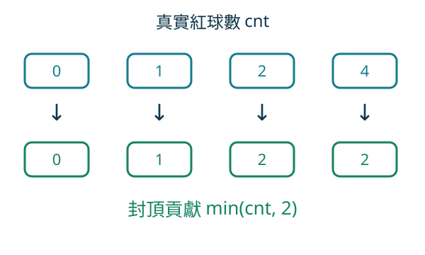

圖中每欄是一種計數狀態。計數 2 與 4 的貢獻都封頂為 2；若分解中有這樣一塊，整個區間就不會恰有一顆紅球。

</div>
<div>

### 哪一次才通知

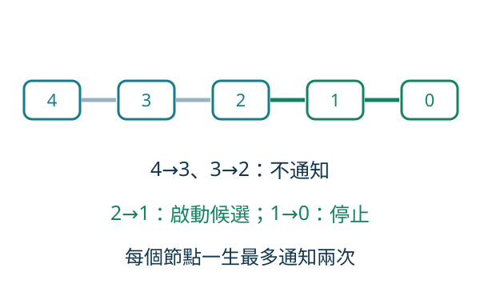

初始 `val` 用的就是各塊的 $\min(cnt,2)$。通知時把 `val` 減 1，兩者才對得起來。若初始用真實紅球數，卻只在這兩次才減，`val` 會是錯的。

</div>
</div>


---


## E｜範例的四個感測器

n = 5，下標 0…4；初始五顆球全是紅色。

| 編號 id | 監視區間 | 分解節點 | 初始 val | 初始啟動？ |
| --- | --- | --- | --- | --- |
| 1 | [2,4] | [2]、[3,4] | 1 + 2 = 3 | 否 |
| 2 | [2,3] | [2]、[3] | 1 + 1 = 2 | 否 |
| 3 | [3,3] | [3] | 1 | 是 |
| 4 | [0,2] | [0,2] | min(3,2) = 2 | 否 |

**val 是各分解節點的封頂貢獻和；初始 v₀ = 3² = 9。**

若第一筆編碼 a′₁ = 3，則真實下標 (3 + 9) mod 5 = 2。


---


## 樣例怎麼掛 / 把 2 號球塗藍

<div class="cols">
<div>

### 樣例怎麼掛

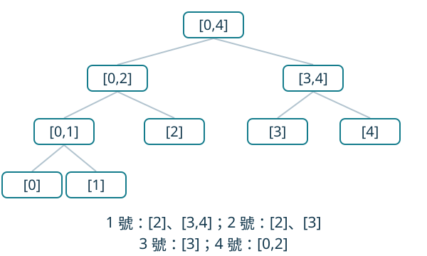

</div>
<div>

### 把 2 號球塗藍

第一筆真實下標是 2。沿路三個節點：

| 節點 | 紅球數 | 通知 |
| --- | --- | --- |
| $[0,4]$ | $5\to 4$ | 不通知 |
| $[0,2]$ | $3\to 2$ | 不通知 |
| $[2,2]$ | $1\to 0$ | 減 1 號、2 號 |

- 1 號：`val` 從 3 到 2，仍不啟動
- 2 號：`val` 從 2 到 1，開始啟動
- 4 號掛在 $[0,2]$ 上，這次不通知，`val` 維持 2
- 啟動的是 2 和 3，$v_1=2^2+3^2=13$

</div>
</div>


---


## E｜初始化與單次更新

<div class="cols">
<div>

### 初始化一次

1. 建樹：cnt[p] = 節點區間長度。
2. 把每個感測器分解成不交的規範節點，編號登記在 bag[p]。
3. 累加 val[id] = 各塊 min(cnt[p],2) 的總和。
4. 把 val = 1 的編號平方加進 ans，先輸出 v₀。

</div>
<div>

### 每次塗藍

1. 用上一個答案解出真實下標 x。
2. 沿根到 x 的路徑，逐一把 cnt 減 1。
3. 新 cnt 是 1 或 0 時，通知 bag 中的感測器。
4. 通知時先移除舊啟動貢獻、val 減 1，再加入新啟動貢獻。
5. 整條路處理完，輸出 ans。

</div>
</div>


---


## 登記區間 / 平方和

<div class="cols">
<div>

### 登記區間

```cpp
void add(int p, int l, int r, int ql, int qr, int id) {
    if (ql <= l && r <= qr) {
        bag[p].push_back(id);
        val[id] += min(cnt[p], 2);
        return;
    }
    int mid = (l + r) >> 1;
    if (ql <= mid) add(p << 1, l, mid, ql, qr, id);
    if (qr > mid)  add(p << 1 | 1, mid + 1, r, ql, qr, id);
}
```

全部登記完，再把 `val[id]==1` 的編號加進 `ans`，這就是 $v_0$。

</div>
<div>

### 平方和

```cpp
void touch(int id) {
    if (val[id] == 1) ans -= 1LL * id * id;
    val[id]--;
    if (val[id] == 1) ans += 1LL * id * id;
}
```

`val` 從 2 到 1 時加進平方和，從 1 到 0 時拿掉。編號從 1 開始。

</div>
</div>


---


## 塗藍 / 在線解碼

<div class="cols">
<div>

### 塗藍

```cpp
void paint(int p, int l, int r, int x) {
    cnt[p]--;
    if (cnt[p] == 0 || cnt[p] == 1)
        for (int id : bag[p]) touch(id);
    if (l == r) return;
    int mid = (l + r) >> 1;
    if (x <= mid) paint(p << 1, l, mid, x);
    else paint(p << 1 | 1, mid + 1, r, x);
}
```

同一感測器的分解節點互不相交；一次塗色至多命中其中一塊，因此最多收到一次通知。

</div>
<div>

### 在線解碼

```cpp
out.push_back(ans); // v0
for (int i = 0; i < n; i++) {
    int x = (a[i] + out.back() % n) % n;
    paint(1, 0, n - 1, x);
    out.push_back(ans);
}
```

`a[i]` 是輸入的 $a'_i$。題目保證解出來的下標互不相同。多測要清空每個 `bag`。

</div>
</div>


---


## 每個區間更新幾次 / E 題容易錯

<div class="cols">
<div>

### 每個區間更新幾次

- 一個區間掛在不超過 $2\log n$ 個節點上
- 每個節點最多通知它兩次
- 所以每個區間最多被碰到 $4\log n$ 次
- 全部區間合計 $O(m\log n)$
- 每次塗色再走一條 $O(\log n)$ 的鏈
- 總時間 $O((n+m)\log n)$
- 空間 $O(n+m\log n)$：樹佔 O(n)，bag 共存 O(m log n) 筆登記

</div>
<div>

### E 題容易錯

- 紅球數一變就通知全部區間
- 初始 `val` 用真實數量，通知卻按封頂規則
- 只改葉子，祖先上的大區間還是舊的計數
- 平方和用 32 位元整數
- 解碼時 $v$ 先加再取模，中間溢位

</div>
</div>


---


## 對照

| | H. 阻止城堡 | E. 感測器 |
| --- | --- | --- |
| 題目要的 | 讓所有攻擊對都消失 | 區間是否恰有一顆紅球 |
| 一個動作影響誰 | 一格最多一橫一豎 | 根到葉子的一條鏈 |
| 可以忽略的變化 | 同一攻擊對內等效的單殺位置 | 紅球數在 2 以上的減少 |
| 保留下來的結構 | 二分圖的邊 | $\min(cnt,2)$ |
| 演算法 | DFS 增廣 | 只在 $2\to 1$、$1\to 0$ 通知 |
| 答案 | $P-M$ | 啟動編號的平方和 |
